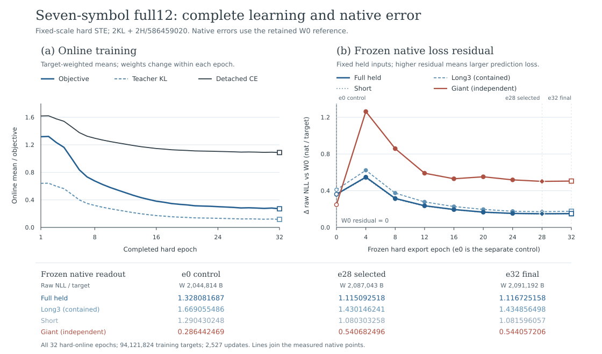

# Full12 seven-symbol teacher-only: complete terminal result

10 November 2026. The fixed recipe completed **32 hard epochs, 94,121,824
training targets and 2,527 optimizer steps**. Learning recovered **58.8639%**
of the initialization's primary native loss. Selected e28 still has a
**+0.148844179152 nat/target** primary residual against the original W0;
the independent giant gains another **+0.254240026234 nat/target** of loss
from q7 e0. Both actual selected-weight payloads grow.

**Training, native export, decoder correctness and same-weight attribution
passed. The fixed recipe's net-code-length gate failed. Stop its new
full-stream/formal runs, continued training and parameter expansion.**

[Full-precision scientific data](results/q7-teacher-only-terminal.json) retain
all 32 online rows, eight frozen native exports, the separate e0 control,
473 paired held pieces, both actual payloads and all four G→M→u16→closed
scopes. The [method and staged observations](q7-teacher-only.md) remain available.



The left panel uses target-weighted online means over changing batch weights.
The right panel uses frozen hard weights on the same held inputs and plots
raw NLL residuals to W0. Lines join measured points. The table preserves
separate e0, selected e28 and final e32 raw-NLL columns for every native scope.

## Complete training contract

The [original fixed-grid recipe](q7-teacher-only.md#one-fixed-method) retains
twelve blocks, width 192, nine KDA blocks, three attention blocks and six
skip connections. Only 111 matrices / 5,868,864 external coordinates train.
All signed BF16 scales and raw parameters stay fixed; Adam projects each
coordinate into `[-3,3]` after every update. Every online epoch uses hard STE.

```
objective = 2 * KL(teacher || student) + 2 * H_soft / 586459020
```

CE is detached and report-only; label-gradient, hidden-MSE and raw-parameter
coefficients are zero. Each of the 2,527 optimizer steps has finite, nonzero
gradients in all 111 coordinate **tensors**. Teacher-cache misses are zero.
The whole-piece manifest has 1,313 pieces / 2,941,307 targets per epoch,
with 42,016 piece consumptions over complete32.

| Online mean | Epoch 1 | Epoch 32 |
|---|---:|---:|
| Detached CE, nat/target | 1.618417650 | 1.087922293 |
| Teacher KL, nat/target | 0.640410587 | 0.116693259 |
| Soft H, million nat | 10.815124 | 10.921231 |
| Actual objective | 1.317703969 | 0.270631171 |

KL falls 81.7784% and the objective falls 79.4619%. Epochs 2, 28 and 31 have
online rebounds. From e28 to e32 the online objective improves while all four
frozen native-domain losses rise. The complete online values and step counts
are in the JSON.

## All frozen native measurements

Values below are raw NLL / target from the original full12 native evaluator.
The primary has 473 pieces / 1,082,505 targets. Its contained long-three
indices `[127,157,181]` contribute 107,647 targets; the remaining 470 short
pieces contribute 974,858. The giant is an independent complete piece with
131,071 targets. Independent scored coverage totals 1,213,576 targets.

| Frozen W | Full held | Long3, contained | Short | Giant, independent | W bytes | κ1 net proxy, B |
|---|---:|---:|---:|---:|---:|---:|
| Original W0 | 0.966248339 | 1.258614301 | 0.933964336 | 0.038986426 | 2,904,325 | 0 |
| q7 e0 control | 1.328081687 | 1.669055486 | 1.290430248 | 0.286442469 | 2,044,814 | report-only |
| e4 | 1.514144681 | 1.881413753 | 1.473589632 | 1.301486586 | 2,073,263 | −56,259,419.34 |
| e8 | 1.281830556 | 1.632676920 | 1.243088956 | 0.897504535 | 2,073,147 | −31,699,810.61 |
| e12 | 1.202357128 | 1.536376376 | 1.165473633 | 0.629712803 | 2,074,570 | −23,301,024.29 |
| e16 | 1.161219019 | 1.485932988 | 1.125363043 | 0.569182767 | 2,076,739 | −18,956,395.97 |
| e20 | 1.132772315 | 1.455100765 | 1.097179756 | 0.590750204 | 2,079,609 | −15,954,857.26 |
| e24 | 1.118957478 | 1.434333855 | 1.084132590 | 0.557162989 | 2,082,984 | −14,501,154.59 |
| **e28 selected** | **1.115092518** | **1.430146241** | **1.080303258** | **0.540682496** | **2,087,043** | **−14,100,683.54** |
| e32 final | 1.116725158 | 1.434856498 | 1.081596057 | 0.544057206 | 2,091,192 | −14,281,578.08 |

Every export preserves the 434-tensor schema, scale delta zero, hard range
`[-3,3]`, original RoPE bytes and exact decoded tensor bytes. All eight trained
exports exceed W0's loss in every native domain. Every trained giant loss
also exceeds q7 e0; its e20 loss rises over e16 before easing at e24/e28.

### Initialization, learning and residual

For each domain, `Q=N(e0)−N(W0)`, `T=N(e28)−N(e0)` and
`R=N(e28)−N(W0)=Q+T`. These are paired native measurements with each weight's
own scales on the same inputs and native family.

| Domain | Initial Q | Learning T28 | Residual R28 | Initial loss recovered |
|---|---:|---:|---:|---:|
| Full held | +0.361833348291 | −0.212989169139 | +0.148844179152 | 58.8639% |
| Long3, contained | +0.410441185150 | −0.238909245534 | +0.171531939616 | 58.2079% |
| Short | +0.356465912404 | −0.210126989761 | +0.146338922643 | 58.9473% |
| Giant, independent | +0.247456043221 | +0.254240026234 | +0.501696069455 | learning adds loss |

Initialization raises loss on 473/473 held pieces. Selected e28 improves
470 pieces / 1,082,150 targets relative to e0 and raises loss on three pieces /
355 targets. Relative to W0, it raises loss on **468 pieces / 1,081,864 targets**
and improves five pieces / 641 targets.

Final e32 minus selected e28 is **+0.001632639689 / +0.004710257071 /
+0.001292799139 / +0.003374710261 nat/target** for full held / long3 / short /
giant. Final primary recovery is 58.4127%. Selected and final remain separate.

## The original unique selector

The frozen criterion is

```
(held_NLL0-held_NLL1)*586215331/(8*ln2) + 2*(W0-W1) + 2*(B0-B1)
```

κ is one; the primary uses its realized target shares. Eligible candidates
have positive epoch/step and hard bytes changed from both q7 initialization
and W0. All eight eligible net proxies are negative. **E28 / step 2213 is the
unique argmax**, leading final e32 by 180,894.535464 B. The original earliest-
epoch tie rule stays fixed.

The selected W has 1,743,461 changed hard symbols (29.70696%) and SHA256
`42cbb05ba360744e8faa8ce14f48faaea7987d07c236eaeec22468717ec7a4da`.
Both actual coder pairs and the four-scope attribution use that exact W.
The JSON preserves the original selector and independent paired-piece proxy
reductions, whose FP64 order differs by about eight microbytes at e28.

Against W0, **both W copies save 1,634,564 B once**. The primary κ1 payload
proxy loses 15,735,247.541288 B, giving net **−14,100,683.541288 B**.
Against q7 e0, selected W grows by 42,229 B, hard entropy by 234,235.068306 nat
and soft entropy by 141,281.878906 nat. Its primary κ1 break-even residual
room is 0.015461805492 nat/target, requiring 95.7268% initial-loss recovery;
measured recovery is 58.8639%.

## Actual same-W code and all four probability scopes

Both actual selected-e28 encode/decode pairs pass; each restored-slice SHA256
matches its original baseline. Original baseline round trips and interval
measurements are reused. The full12 codec, prepared source, vocabulary mask,
D and O stay fixed. Both deployed UPX B copies are 181,956 B with the same
SHA256, so the double-B delta is zero. Both probe files are 434,544 B.

| Actual full payload | Input bytes | Baseline P, B | E28 P, B | Payload growth, B | History |
|---|---:|---:|---:|---:|---|
| prefix8 | 8,388,608 | 1,072,279 | 1,205,055 | +132,776 | continuous from stream zero |
| article-q2 | 1,048,576 | 208,769 | 237,498 | +28,729 | fresh cold at source offset 293,232,482 |

G is observed neural f16/guarded probability loss; M is pre-SSE mixer-logit
ideal loss; u16 is the actual range-input ideal loss. The following table uses
the **all-byte mask** and candidate−baseline growth. The JSON also retains
each side, the same NN-target mask, first-token fallback, override counts,
explicit range residual, interval endpoints and final Flush.

| Actual score scope | Score B / NN targets | G growth, bits | M growth, bits | u16 growth, bits | Closed bytes, W0→e28 | Closed growth, B |
|---|---:|---:|---:|---:|---:|---:|
| prefix8 mature | 1,041,690 / 1,041,397 | 251,783.277296 | 180,857.942933 | 179,940.696825 | 177,427→199,921 | +22,494 |
| q2 all | 1,048,576 / 1,048,367 | 284,947.524732 | 231,020.412069 | 229,833.784392 | 208,768→237,497 | +28,729 |
| q2-non-direct-update-input | 1,037,391 / 1,037,183 | 282,700.994341 | 229,395.514231 | 228,235.777323 | 206,871→235,400 | +28,529 |
| old-w64-held-by-seed414-role | 505,309 / 505,207 | 120,432.883644 | 88,716.819379 | 88,239.422276 | 84,844→95,873 | +11,029 |

The mature interval is prefix `[7344758,8386448)`, after continuous warm
history. Its original production scope contains 1,671 direct-train input
bytes / 1,670 targets. Q2's direct-train input is parent `[585545,596730)`.
The two exclusion scopes retain their parent q2 PPMd/mixer/range history from
byte zero and sum `closed(end)−closed(begin)` over the original fixed parts.
They overlap and each has its own paired result.

**`old-w64-held-by-seed414-role` is the original W64 held-position window
with seed414 direct-train input excluded. Its current seed414 randomized
validation input count is zero.** The actual seed414 primary native validation
retains its separate 473-piece scope. Four candidate interval parts passed;
their boundaries and both sides' exact results are in the JSON.

NN-target G→u16 loss-transfer ratios are 0.714655 / 0.806613 / 0.807369 /
0.732744 for the four rows. First-fallback u16 growth is +2.515905 /
−8.575252 / −8.318338 / −6.991320 bits; override counts match per side/mask.
All-byte range-residual growth is +1.412897 / −0.223049 / −0.472165 /
−0.927785 B. Each scope satisfies `u16 growth / 8 + residual growth = closed
growth`; the large loss is already present in the same-W prediction/mixing
layers, with boundary residuals at the few-byte scale.

## Two-copy package and whole-archive acceptance

The unchanged package contract is `S=P+2B+2D+O+2W+69`.
D is 100,098 B and O is 201,111 B. Fixed package size changes
6,573,938→4,939,374 B, saving the same 1,634,564 B once.
The two finite sample payloads lose 161,505 B together; their shared fixed
component gives **+1,473,059 B** saved. That positive component's scope is
these two samples and one shared fixed-package difference.

Whole-stream constant-rate scenarios use the 586,459,020-byte prepared stream
and each named actual score, charging double-W and double-B once:

| Measured rate source | Scenario net saved, decimal MB |
|---|---:|
| prefix8 full payload | −7.647987 |
| prefix8 mature closed interval | −11.029289 |
| q2 full cold | −14.433304 |
| q2-non-direct-update-input | −14.493482 |
| old-w64-held-by-seed414-role | −11.165637 |

The actual whole-stream saved-size field is `null`; its original measurement
status is `awaiting_actual_full_stream_package`. **The current recipe decision
is stop.** Official acceptance has the entire official-original archive and
its real two-copy package as its domain, with complete decode verification and
`S1≤floor(99×L/100)` using the record L at that acceptance. The historical
1,004,247-byte award-gate reference remains a named historical scenario.

## Inputs, arithmetic and scientific sources

Both causal training methods use the original seed414 whole-piece manifest
and original teacher checkpoint. Q7 trains the recoded seven-symbol
initialization against a read-only complete-distribution cache with
`integer-units-before-native-BF16-fold`. The older full12 q15 control starts
from original W0 and uses `CE+KL+2H/586459020` with scaled FP32 GEMM for student
and teacher. Their staged comparison is a whole-method comparison containing
grid/scale initialization, objective and CPU arithmetic changes. This report's
Q/T/R uses W0, q7 e0 and q7 exports on the same full12 native evaluator.

The [integer-unit certificate](integer-unit-exactness.md) covers normal finite
signed BF16 scales, finite products and FP32 RNE. For q7, `K≤768`, activation
magnitude ≤128 and weight magnitude ≤3 give a partial-sum bound of 294,912,
inside FP32's exact-integer range. The actual fold is the FP32 product of two
BF16-derived scales. End-to-end KDA/state/attention quality is measured by the
native and coded results above.

The primary's long3 target share is 9.94425%; the corresponding full-stream
length stratum is 3.13402%. Pieces above 65,536 B contribute zero primary
targets and 6.62084% of full-stream targets. The selector retains its original
realized-target-share contract; the independent giant and whole-stream rate
scenarios retain their named domains.

The JSON records SHA256 provenance for the original scientific readouts and
the public [terminal reader](q7-terminal-readout.py), [trainer](integer-coordinate-qat.py),
[recipe helper](q7_teacher_only.py), [codec audit](depth-mixed-audit.py),
[closed-interval reader](mixed-interval.cpp), [actual e0 control](results/q7-initial-native.json),
[W0/held pairing](results/causal-first-eleven-epochs.json),
[admitted preflight](results/q7-teacher-only-preflight.json) and
[direct-update exposure](mixed-sample-exposure.md). The publication consists
of numeric scientific measurements, the figure and its source.

Regenerate the figure with the Python standard library:

```sh
python3 -B research/plot-q7-teacher-only-terminal.py
```
